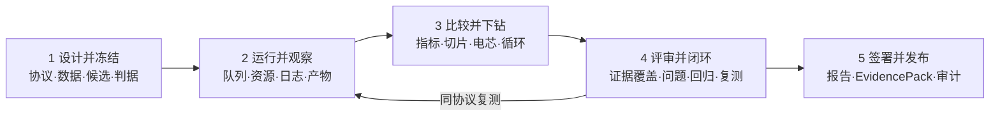
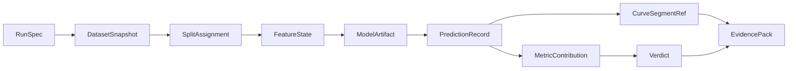

# SOH 测评页 × 详情看板深度融合重构方案（V3）

> 输出日期：2026-08-10  
> 目标：将当前“测评流程页 + 独立 SOH 看板”重构为一个以评测案例为中心、从判定可连续钻取到原始证据的工作台。  
> 配套原型：`docs/mockups/soh-evaluation-deep-fusion-v3.html`

## 1. 结论先行

当前问题不是配色或组件风格不一致，而是产品对象被拆成了两套：

- 测评页管理“上传、配置、执行、发布”；
- 详情看板管理“数据集、场景、算法、特征、电池、循环曲线”；
- 两端仅传递筛选参数，没有共享“比较结论由哪些样本和证据构成”的业务上下文；
- 结果是导航重复、筛选重复、口径重复，用户从指标跳到曲线时需要重新理解自己正在看什么。

V3 的核心重构是：**不再把详情看板当作一个页面，而把它拆成评测案例内部的“证据层”**。统一主对象为 `EvaluationCase`，统一下钻主线为：

```text
比较结论 → 候选算法 → 工况切片 → 电芯 → 循环 → 原始/派生证据 → 判据贡献 → 评审动作
```

用户在任何层级都能看到同一案例、同一协议、同一数据快照、同一模型与同一判据；从结论到原始 V/I/T 证据不超过 3 次操作。

## 2. 资料范围与关键输入

本方案交叉读取了 `D:\SOH_V&V` 中的 22 份 Markdown、17 份 HTML（其中 1 组为内容完全重复的站点副本）、1 份 DOCX，以及竞品界面截图与现有 mockup。重点输入如下：

- Claude 方案：Phase 0 五对象合同、逐单元表、协议/数据/环境指纹、append-only ledger、真值比较与复现门禁；
- Kimi PHM 调研：商业平台缺少公开基准和第三方可验证证据层，独立测评应成为“研究框架—商业开发—运行监控”之间的中间基础设施；
- SOH 六份专题调研：M1–M8 指标、P1–P10 协议、跨电芯/跨工况泛化、UQ、IC/DV、弱切片、回归集与报告证据链；
- 竞品 UI：TWAICE 的“总体分布—所选资产—单点曲线”层级，以及 ACCURE 的阈值区、异常任务、审计与复测闭环；
- 当前实现：外层 `frontend/app/index.html` 与内层 `frontend/app/battery-dashboard/index.html` 形成重复筛选和 iframe 视觉断层。

资料质量说明：`SOH测评工具方案设计文档.docx` 可提取 1,123 个正文段落，但缺失 OOXML 页面尺寸节点，系统 Word 也报文件可能损坏，无法完成页面渲染；其主体内容已通过同目录 Markdown 版本交叉读取。正式归档前建议重生成该 DOCX。

## 3. 当前割裂的四个根因

### 3.1 信息架构重复

外层同时存在“训练测评 / 推理测评 / 全局诊断 / SOH 完整看板”，看板内部又重复“数据集 / 场景 / 算法 / 特征 / 电池”。用户无法判断一次测评究竟是任务、结果，还是另一套分析产品。

### 3.2 状态传递过薄

现有跳转主要传 `dataset / algorithm / feature / battery` 等过滤值，但没有传递：

- 当前比较集与 champion；
- 协议版本、划分与数据快照；
- 当前判据与阈值来源；
- 聚合指标对应的样本集合；
- 当前电芯/循环对总指标的贡献；
- 评审状态、问题单与 EvidencePack。

因此“看到了同一算法”不等于“看到了产生该结论的同一证据”。

### 3.3 聚合结果与原始证据是两条数据管线

测评页展示任务与聚合 KPI；看板另行读取 SOH 轨迹、3σ 与 V/I/T。缺少 `MetricContribution → PredictionRecord → CurveSegment` 的稳定主键，无法解释一个 MAE、失败判据或弱切片究竟由哪些 cycle 贡献。

### 3.4 状态语义混用

“运行完成”“证据齐全”“判据通过”“评审签署”目前容易被一个绿色状态替代。四者必须拆开：

| 状态轴 | 回答的问题 | 示例 |
|---|---|---|
| Execution | 任务跑完了吗 | queued / running / completed / failed |
| Evidence | 证据完整吗 | 8/9 complete / missing raw curve |
| Verdict | 满足判据吗 | pass / conditional / fail / not-applicable |
| Review | 谁确认过 | draft / in-review / approved / rejected |

只有四个状态均满足发布策略，案例才可标记为“已验证”。

## 4. 重构目标与设计原则

### 4.1 北极星任务

在同一个页面内回答五个连续问题：

1. 谁在同一协议下更好，好多少，差异是否可信？
2. 差异来自哪些工况、电芯和寿命阶段？
3. 某个异常 cycle 的真值、预测、区间与原始曲线是什么？
4. 这条证据如何贡献到指标和最终判定？
5. 失败如何进入问题单、回归集并完成复测？

### 4.2 六条原则

1. **案例优先**：训练/推理是案例内的运行类型，不再是两套顶层产品。
2. **上下文常驻**：案例、比较、协议、快照、候选、资产、循环在页面顶部持续可见。
3. **结论与证据同屏**：中心显示证据，右侧同时显示判据、覆盖度与评审动作。
4. **聚合可解释**：所有 KPI 都可反查到 `MetricContribution` 和样本集合。
5. **真实来源显式**：实测、仿真、演示、缺失、不可用必须有独立来源标记，禁止用生成数据冒充证据。
6. **失败成为资产**：弱切片可一键生成问题、加入回归集并发起同协议复测。

## 5. 目标信息架构

顶层导航从 7 个并列入口收敛为 5 个稳定对象：

| 新入口 | 核心对象 | 吸收的当前入口 |
|---|---|---|
| 可信总览 | 组合级结论、待评审、风险 | 当前首页、全局诊断、任务摘要 |
| 评测案例 | 设计、运行、比较、证据、复测 | 训练测评、推理测评、任务历史、SOH 完整看板 |
| 数据与协议 | 数据快照、划分、QC、协议 | 上传资源、数据范围、协议选择 |
| 模型资产 | 模型、特征、环境、发布版本 | 模型资产库、算法推荐 |
| 发布与审计 | 报告、EvidencePack、签署、台账 | 发布步骤、报告与审计能力 |

### 5.1 评测案例内部不是子页面，而是连续阶段



阶段条只表达进度与可进入性；用户始终处于同一个 `EvaluationCase`，不会丢失选择。

## 6. 融合工作台布局

### 6.1 常驻案例头

显示：`CASE ID / 比较名称 / 协议版本 / 数据快照 / 判据集 / 执行状态 / 证据覆盖 / 评审状态`。任何筛选变化都写入 URL 与可分享上下文。

### 6.2 三栏证据工作区

| 区域 | 内容 | 作用 |
|---|---|---|
| 左：比较范围 | 候选、champion、工况矩阵、电芯/样本树 | 明确“正在比较谁、在哪些范围” |
| 中：证据画布 | 总体轨迹、Parity、误差演化、热力图、V/I/T、IC/DV、特征窗 | 在同一坐标系中从聚合下钻到 cycle |
| 右：判定检查器 | 阈值、贡献、证据覆盖、血缘、问题与复测 | 解释“为什么得出该结论、下一步做什么” |

底部逐样本表是图表的等价入口；点击行、图点或工况格，三栏使用同一个选择状态同步更新。

### 6.3 默认阅读顺序

```text
案例头 → 对比结论 → 最弱切片 → 代表电芯 → 异常 cycle → 原始曲线 → 指标贡献 → 评审动作
```

不再以“先进入看板，再重新筛选”作为路径。

## 7. 统一业务上下文

```ts
type EvaluationContext = {
  caseId: string;
  comparisonId: string;
  runId: string;
  candidateId: string;
  championId?: string;
  protocolVersion: string;
  criterionSetVersion: string;
  datasetSnapshotId: string;
  splitAssignmentId: string;
  modelArtifactId: string;
  featureStateId: string;
  sliceId?: string;
  assetId?: string;
  sampleId?: string;
  cycleId?: number;
  evidenceTab: "overview" | "raw" | "icdv" | "features" | "contribution";
  compareCycleIds: number[]; // 最多 3 个
  sourceClass: "measured" | "simulated" | "demo";
};
```

### 7.1 URL 是可恢复视图，不是数据源

建议形式：

```text
/cases/EV-2026-0142/evidence
?comparison=cmp-07
&candidate=pinn-v1.2
&slice=43c-2c
&asset=b2c9
&cycle=438
&tab=raw
```

刷新、分享、浏览器前进后退均能恢复视图；服务端仍以不可变 ID 和权限校验为准。

### 7.2 选择状态的同步规则

- 选择候选：刷新 KPI、工况矩阵、资产排序、判据贡献；保留协议和快照；
- 选择工况：资产列表过滤到该切片，自动定位最大贡献样本；
- 选择电芯：更新 SOH 轨迹、寿命阶段和逐 cycle 表；
- 选择 cycle：原始曲线、IC/DV、特征窗、残差贡献和证据血缘同步定位；
- 加入对比：最多保留 3 个 cycle，统一归一化时间轴，并显示来源与采样率差异；
- 任何对象不可用时明确显示 `N/A + 原因`，不绘制伪曲线。

## 8. 证据数据合同

最小可追溯链必须贯通：



### 8.1 必须新增/固化的主键

| 实体 | 关键字段 | 说明 |
|---|---|---|
| PredictionRecord | run_id, asset_id, cycle_id, y_true, y_pred, interval | 逐 cycle 预测事实表 |
| MetricContribution | metric_id, record_id, weight, contribution | 聚合 KPI 的可解释桥梁 |
| CurveSegmentRef | record_id, signal, uri, start, end, sampling | 原始/派生曲线引用，不复制大数组 |
| Verdict | criterion_version, scope, observed, threshold, result | 判据必须带版本和适用范围 |
| EvidenceCoverage | required, available, missing_reason | 区分没有数据、未生成和无权限 |
| ReviewAction | issue_id, regression_set_id, retest_run_id | 失败闭环关系 |

### 8.2 禁止的实现

- 以数组下标关联图点与原始曲线；
- 聚合 JSON 和 dashboard JSON 分别计算指标；
- 仅凭“运行完成”展示绿色“已验证”；
- 在真实案例中用插值或随机曲线填补缺失证据；
- 在前端硬编码标准阈值而不显示来源与版本。

## 9. 前端组件拆分

```text
EvaluationCaseShell
├─ CaseHeader
│  ├─ StageRail
│  └─ ContextRibbon
├─ EvidenceWorkspace
│  ├─ ComparisonScope
│  │  ├─ CandidateList
│  │  ├─ SliceMatrix
│  │  └─ AssetSampleTree
│  ├─ EvidenceCanvas
│  │  ├─ ComparisonSummary
│  │  ├─ SohTrajectory | Parity | ErrorEvolution | SliceHeatmap
│  │  ├─ CycleCursor
│  │  └─ RawSignals | Icdv | FeatureWindow | Contribution
│  └─ VerdictInspector
│     ├─ CriterionStack
│     ├─ EvidenceCoverage
│     ├─ LineageTrail
│     └─ IssueRetestActions
└─ SampleContributionTable
```

### 9.1 技术落地建议

- 保持现有 Vite/原生模块边界，先引入共享 `evaluation-context` store；
- 服务端状态用 TanStack Query 或现有请求层，局部选择用轻量 store；
- 分析图使用 ECharts；百万级原始序列使用 uPlot/Canvas + LTTB，仅视觉降采样，统计仍用全量数据；
- 表格虚拟化，图表和表格共享 `record_id`；
- iframe 迁移期仅作为只读适配器，禁止继续增加功能。

## 10. 接口建议

### 10.1 工作台聚合接口

```http
GET /api/v2/cases/{case_id}/evidence-workspace
  ?comparison_id=cmp-07
  &candidate_id=pinn-v1.2
  &slice_id=43c-2c
  &asset_id=b2c9
  &cycle_id=438
```

首屏返回：案例上下文、比较摘要、切片矩阵、资产列表、判据和证据覆盖；大曲线按需加载。

### 10.2 曲线接口

```http
GET /api/v2/prediction-records/{record_id}/curves
  ?signals=voltage,current,temperature,ic,dv
  &resolution=viewport
```

响应必须携带：原始点数、返回点数、降采样方法、单位、时间轴、来源类型、缺失原因。

### 10.3 闭环接口

```http
POST /api/v2/review-actions/issues
POST /api/v2/regression-sets/{id}/members
POST /api/v2/cases/{case_id}/retests
POST /api/v2/evidence-packs/{id}/sign
```

复测必须引用原案例、问题单、同一协议或已说明的协议差异。

## 11. 从当前实现到目标态的迁移

### Phase 0：统一外壳与语义（1 个迭代）

- 新建 `EvaluationCaseShell` 和 `EvaluationContext`；
- 将“训练/推理”改为案例内运行类型；
- 移除顶层“SOH 完整看板”入口，保留临时深链；
- 统一状态为 Execution / Evidence / Verdict / Review 四轴；
- 前端先用适配器读取现有数据，不改变计算口径。

**验收**：切换候选、电芯、cycle 后三栏同步；URL 刷新可恢复；旧详情入口可回退。

### Phase 1：打通逐样本证据（1–2 个迭代）

- 建立 `PredictionRecord`、`MetricContribution`、`CurveSegmentRef`；
- 让聚合 KPI 与看板读取同一结果事实表；
- 增加证据覆盖和缺失原因；
- 完成总体 → 切片 → 电芯 → cycle → V/I/T 的三击下钻。

**验收**：任一聚合指标可列出贡献样本；任一曲线可回到运行、数据与模型指纹。

### Phase 2：闭环与双写校验（1 个迭代）

- 接入问题单、回归集、同协议复测；
- 旧 dashboard JSON 与新事实表双写，逐字段对账；
- 报告和 EvidencePack 引用统一实体 ID。

**验收**：弱切片生成问题后可追踪到复测结果；新旧 KPI 在容差内一致。

### Phase 3：去 iframe 与发布门禁（1 个迭代）

- 将剩余图表迁入 `EvidenceCanvas`；
- 下线 iframe 路由和重复筛选；
- 证据完整度、判据与评审签署共同控制发布；
- 建立 EvidencePack 哈希与 append-only 审计事件。

**验收**：生产路径不存在 iframe；缺少必需证据或签署时无法标记“已验证”。

## 12. 关键验收场景

### 12.1 连续下钻

1. 打开案例 EV-2026-0142；
2. 选择 PINN4SOH；
3. 点击 `43°C × 2C` 弱切片；
4. 系统自动定位 b2c9；
5. 点击 cycle 438；
6. 同屏显示真值、预测、区间、V/I/T、IC/DV、特征窗和该点 MAE 贡献；
7. 右侧判据与证据覆盖同步更新。

### 12.2 防止错误“通过”

- 运行完成但缺原始曲线：Execution=completed，Evidence=incomplete，Verdict 可计算，Review 不可签署；
- 无真值：Accuracy verdict=N/A，不允许展示“精度通过”；
- 仿真数据：始终显示 Simulation 来源，不得进入真实验收 EvidencePack；
- 阈值无版本：判据显示不可审计，发布被阻止。

### 12.3 闭环

- 从异常 cycle 创建 ISSUE；
- 将该 cycle 和同切片相邻样本加入回归集；
- 发起同协议复测；
- 对比原 run 与 retest 的贡献变化；
- 评审后签署新 EvidencePack，旧包保持不可变。

## 13. 量化成功指标

| 指标 | 目标 |
|---|---:|
| 结论到原始曲线交互次数 | ≤ 3 |
| 上下文丢失率（返回/刷新后） | 0% |
| 聚合 KPI 可追溯到逐样本覆盖率 | 100% |
| 必需证据缺失仍可发布次数 | 0 |
| 重复筛选控件数量 | 减少 ≥ 60% |
| iframe 生产依赖 | 0 |
| 弱切片到复测结果的可追踪率 | 100% |
| 1440 / 1280 / 768 / 375 宽度核心任务可用 | 100% |

## 14. 决策与取舍

- **不做“大而全驾驶舱”**：地图、实时 SCADA、3D 电池包不是独立测评的核心；
- **不把所有图一次放满**：默认展示回答当前判定所需的图，其他证据按上下文切换；
- **不追求单一综合分替代证据**：排名必须附协议、切片、CI/UQ 和判据；
- **不先重写后端**：先建立共享上下文和读适配器，再迁移事实表，降低中断风险；
- **不延续 iframe 功能开发**：迁移期只修阻断问题，新增能力进入融合工作台。

## 15. 配套 mockup 的验证重点

配套 HTML 是独立可打开的交互原型，包含：

- 常驻案例头、阶段条与统一上下文；
- 候选 / 工况 / 电芯 / cycle 四级联动；
- SOH 真值、预测、置信带与异常点；
- 原始 V/I/T、IC/DV、特征窗、指标贡献切换；
- 判据、证据完整度、血缘、问题与复测同屏；
- URL hash 状态恢复示意与 375px–1440px 响应式布局。

原型使用明确的“设计数据”标识，不代表真实测评结论。
