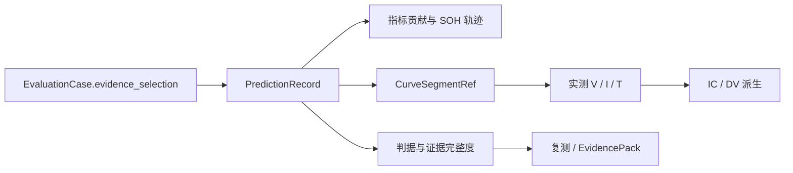

# SOH Evaluation 阶段 3.1：原生证据画布与去 iframe

更新时间：2026-08-15

## 1. 阶段结果

阶段 3.1 已将 SOH 轨迹与原始曲线合并到“评测与证据”工作台。生产入口不再加载 `battery-dashboard` iframe，也不再维护第二套数据集、模型、电芯和 Cycle 选择器。

同一个 `PredictionRecord` 现在同时驱动：

- SOH 真值、预测值、置信区间与逐点指标贡献；
- `CurveSegmentRef`、原始电压、电流、温度；
- 由实测 V / I / time 派生的 IC 与 DV；
- 判据检查、证据完整度、血缘、问题、复测和 EvidencePack。

`frontend/app/battery-dashboard` 仍可作为算法包导入和离线打包的源资产，但不再属于生产页面运行时。

## 2. 单一事实流



页面内只有一个共享选择上下文：`candidate + dataset + asset + cycle + record_id`。轨迹和曲线通过两个内容页签切换，不新增顶层导航或业务流程按钮。

## 3. 规范曲线接口

```text
GET /api/v2/prediction-records/{record_id}/curves
    ?case_id={case_id}
    &signals=voltage,current,temperature,ic,dv
    &resolution=viewport
    &max_points=480
```

接口行为：

- `case_id` 与 `record_id` 必须解析到同一案例中的规范预测记录；
- 按 `CurveSegmentRef.curve_key` 定位曲线，并校验源文件 SHA-256；
- 返回 `thumbnail / viewport / full` 三档采样，当前画布使用 `viewport`；
- V / I / T 直接来自测量曲线；缺少直接 IC / DV 时，仅从实测 V / I / time 派生；
- 返回缺失信号、采样点数、派生来源和 3.7–4.1 V 特征窗；
- 找不到指定记录、曲线缺失或摘要不一致时显式失败，不回退到其他 Cycle。

## 4. 界面收口

“评测与证据”中栏保留两个上下文页签：

1. **SOH 轨迹**：选择代表电芯和 Cycle，显示真值、预测、区间、残差、MAE 贡献与记录主键；
2. **原始 V / I / T / IC / DV**：直接读取同一记录，显示规范记录、曲线摘要、采样信息、特征窗和五类曲线。

曲线页没有额外筛选器和“重新运行”类主按钮。只有读取失败时出现一次性的“重新读取”恢复动作。既有签署、问题和复测动作仍由案例状态决定。

## 5. 验收记录

真实回归门禁：

- 门禁：`GATE-20260815-789FD4C7`；
- 状态：`passed`，5 / 5 检查符合预期；
- 案例：`EV-20260815-A1787FE6` v4；
- Profile：`phase30-gate-nasa-20260815-055355`；
- 代表记录：`nasa:B0018:77`；
- 曲线：200 / 200 点，V / I / T / IC / DV 全部可用；
- 曲线摘要与案例固定的 `CurveSegmentRef` 一致；
- IC / DV 来源：`derived from measured V/I/time`。

自动验证：

- Python 全量测试：309 项通过，只有既有 chemistry-out 单数据集混杂告警；
- 阶段定向后端测试：30 项通过；
- 前端静态回归：4 组通过；
- 浏览器：1366×768、1024×768、390×844 均无横向溢出，证据页签与状态标签无重叠；
- 生产页面 iframe 数量：0；
- 五类曲线卡片：5；
- 浏览器控制台错误与警告：0。

验收页面：

```text
http://127.0.0.1:8765/SOH_eval/frontend/app/index.html?profile=phase30-gate-nasa-20260815-055355&mode=audit&v=phase31-native-evidence-20260815c
```

## 6. 阶段边界

阶段 3.1 完成的是生产路径去 iframe、原生曲线渲染和同一事实源贯通。阶段 3.2 已根据产品优先级调整为“完成组合库与泛化验证”；外部私钥、证书签名、密钥轮换和签名撤销改为独立的后续安全阶段，不在本阶段伪装为已完成。
