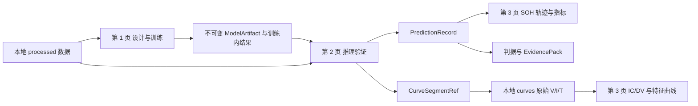

# SOH Evaluation 阶段 3.9：本地数据迁移与三页连通性

更新时间：2026-08-17

## 1. 交付结论

项目采用方案 B，将已进入监督训练、推理和证据链的数据迁移到
`D:\SOH_eval\data`，不再把 `D:\battery_SOH\data` 作为默认运行依赖。
上游目录保持只读、未删除，项目内清单由 `data/manifest.json` 固定。

本次迁移得到 306 个本地文件、24,288,608,875 字节、9 个处理数据集、
235,320 条记录、235,288 个唯一电池-Cycle 和 226 个电池。复制清单逐项核对通过。

## 2. 三页单一事实流

- 第 1 页只产生训练模型身份、训练内指标和训练数据范围；不把训练结果伪装成跨数据集泛化结论。
- 第 2 页沿用不可变模型产物，在同数据集留出集或相同化学体系的其他数据集上生成推理记录。
- 第 3 页只显示已完成训练或推理并可解析到实际运行目录的组合；候选、数据集、特征、协议、模型摘要和曲线共用同一个案例上下文。
- 辅助页“数据目录”读取同一份服务端清单，显示记录量、Cycle 数、电池数、化学体系、最大容量、本地状态和用途。

## 3. 数据使用边界

| 数据集 | 化学体系 | 记录/Cycle | 电池 | 本地原始数据 | 典型用途 |
|---|---|---:|---:|---|---|
| calce_cs2 | LCO | 15,411 | 13 | 是 | 训练、同源留出、LCO 迁移 |
| hust | LFP | 146,122 | 77 | 是 | 训练、同源留出、LFP 迁移 |
| nasa | LCO | 2,723 | 32 | 是 | 训练、同源留出、LCO 迁移 |
| oxford | LCO/NCO | 519 | 8 | 是 | 训练、同源留出、近化学体系迁移 |
| rwth_isea_public | LFP | 2,707 | 8 | 否 | 已处理特征评测；原始证据受限 |
| snl_lfp | LFP | 64,905 | 18 | 是 | 训练、同源留出、LFP 迁移 |
| uconn | LFP | 2,855 / 2,823 | 64 | 是 | 训练、同源留出、LFP 迁移 |
| smoke_eval_demo | 未知 | 42 | 3 | 否 | 流程冒烟，不用于正式迁移结论 |
| soh_quickstart_demo | 未知 | 36 | 3 | 否 | 快速演示，不用于正式迁移结论 |

“原始数据已迁移”不等于每一个电池、每一个 Cycle 都已经转换成前端曲线资产。
第 3 页轨迹点会分别标记“含原始曲线”和“仅轨迹”，避免把证据覆盖差异误认为程序故障。

## 4. 页面连通性修复

1. 统一默认数据根目录到 `D:\SOH_eval\data`，仍允许通过 `SOHBENCH_DATA_DIR` 显式覆盖。
2. 训练、推理、门禁脚本、API 和测试不再默认读取旧的外部数据目录。
3. 数据目录 API 从 `data/manifest.json` 返回本地状态、来源、用途和校验摘要。
4. 第 3 页只列出当前推理任务或用户保存组合包含的数据集，不再继承其他运行的旧资产/Cycle。
5. 轨迹使用按候选、数据集和电池分片的 `prediction-trajectory-index/2.1`，不再读取 900 MB 预测记录文件后才绘图。
6. 逐点证据使用 SQLite 精确定位；历史运行里的重复记录主键被确定性去重并计数，不再导致整页失败。
7. 原始曲线采用带文件版本的内存缓存；缺少温度或缺少某个 Cycle 曲线时显式说明，不回退到错误记录。

## 5. 当前真实案例复核

案例 `EV-20260817-89CA6203` 的运行 `20260816T210844-32d6ce84` 已复核：

- HUST：轨迹约 263 ms，2,057 点；原始 V/I/IC/DV 首次约 748 ms，温度源信号缺失；
- NASA：轨迹约 56 ms，自动选择有曲线证据的 B0018；原始 V/I/T/IC/DV 约 78 ms；
- UConn：轨迹约 67 ms；原始 V/I/IC/DV 约 128 ms，温度源信号缺失；
- 同一 HUST 曲线缓存后约 122 ms。

这些数值是本机当前运行测量，不是性能承诺。原始温度缺失属于已迁移曲线资产的源数据覆盖，
轨迹无法加载和跨数据集继承旧资产属于程序问题，已分别处理。

## 6. 运维与重建

- 重建清单：`python scripts/build_data_manifest.py`
- 默认数据根：`D:\SOH_eval\data`
- 后端健康检查：`http://127.0.0.1:8001/api/health`
- 前端入口：`http://127.0.0.1:8765/SOH_eval/frontend/app/index.html`

大体量原始、处理和曲线文件由 `.gitignore` 排除；只提交 `data/README.md` 和
`data/manifest.json`。因此换机时必须执行受控复制并重建清单，不能只依赖 Git checkout。
