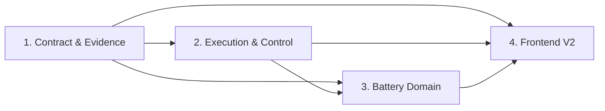

# SOH Verification Fabric Program Implementation Plan

> **For agentic workers:** REQUIRED SUB-SKILL: Use superpowers:subagent-driven-development (recommended) or superpowers:executing-plans to implement this plan task-by-task. Steps use checkbox (`- [ ]`) syntax for tracking.

**Goal:** 将当前 SOH_eval 渐进迁移为本机优先、测评可信、证据可追溯且前端职责清晰的 SOH Verification Fabric。

**Architecture:** 先以兼容双写方式建立版本化契约、目标剥离数据视图和 EvidencePack，再将执行迁入独立 Worker 与 SQLite 状态机。Battery SOH 作为首个 Domain Pack，前端 V2 只消费冻结的 API v2 和证据对象。

**Tech Stack:** Python 3.11+、pandas、NumPy、SciPy、scikit-learn、jsonschema、SQLite、原生 ES Modules、Plotly.js、Lucide、Node test runner、Playwright。

## Global Constraints

- 数据根目录保持 `D:\battery_SOH\data` 可配置，测试不得依赖该目录存在。
- API 进程不得导入上传的 Python 插件或反序列化 Pickle。
- 测试算法视图不得包含 `soh` 或其他 LabelSpec 目标列。
- 特征拟合、填充、缩放、选择和校准只在训练折或声明的校准折执行。
- 所有运行、模型和产物使用不可覆盖的 run-scoped 标识和 SHA-256 摘要。
- `execution_state`、`outcome`、`verdict` 是三个独立字段。
- 旧 API、旧前端 JSON 和离线 HTML 在迁移期继续可用，但必须由新证据生成或进行一致性核对。
- 实时 API、离线快照和演示数据不得在同一页面静默混合。
- 正式排行榜只接收 `SIGNED`、comparison key 一致且满足 PolicySpec 的运行。
- 所有手工代码修改遵循测试先行；每个任务单独提交。

---

## Sub-project Plans

| 顺序 | 子计划 | 可独立交付的结果 | 依赖 |
|---|---|---|---|
| 1 | [Contract & Evidence Foundation](2026-07-14-soh-fabric-contract-evidence-foundation.md) | 无目标泄漏、结构化失败、稳定 comparison key、EvidencePack 双写 | 已批准设计 |
| 2 | [Local Execution & Control Plane](2026-07-14-soh-fabric-local-execution-control-plane.md) | SQLite 状态机、CAS、独立 Worker、API v2、本机 T2 隔离 | 子计划 1 |
| 3 | [Battery SOH Domain & Benchmark](2026-07-14-soh-fabric-battery-domain-benchmark.md) | 数据卡、原始曲线索引、LFP 政策、五赛道和 7 数据集签署基线 | 子计划 1、2 |
| 4 | [Frontend V2 & Evidence Explorer](2026-07-14-soh-fabric-frontend-v2.md) | 九页面工作台、运行恢复、公平比较和 SOH 样本曲线下钻 | 子计划 1、2；曲线部分依赖 3 |

## Dependency Graph



## Program Checkpoints

### Checkpoint A：测评结果可信

- [ ] 构造的目标泄漏和未来信息泄漏全部被测试阻断。
- [ ] 全失败为 `failed`，部分失败为 `partial`。
- [ ] 同一黄金运行产生稳定 comparison key 和可校验 EvidencePack。
- [ ] 旧 leaderboard 与新证据的兼容视图可自动核对。

### Checkpoint B：执行边界可信

- [ ] API 进程不加载源码或 Pickle。
- [ ] 挂起 Worker 可超时终止，API 和其他任务保持可用。
- [ ] 取消、重试和进程重启后状态可从 SQLite 事件恢复。
- [ ] 并发运行和模型产物互不覆盖。

### Checkpoint C：Battery SOH 基准可信

- [ ] 当前 7 数据集均有 DatasetSpec、LabelSpec、checksum 和 QC manifest。
- [ ] 核心公平榜使用统一 RunSpec、3 seeds、资产 bootstrap CI 和失败覆盖率。
- [ ] 实验室、二次寿命、现场和无标签 OOD 进入不同赛道。
- [ ] 原始曲线可用样本具有 RawSegmentRef 和 FeatureProvenance。

### Checkpoint D：前端结论可信

- [ ] 没有重复顶层导航或训练/推理/证据 KPI 混用。
- [ ] 刷新可恢复活动 run 和 URL 范围。
- [ ] 不可比结果不能进入同一比较视图。
- [ ] 任一正式结论三次交互内到逐样本证据。
- [ ] 375、768、1024、1440px 无内容溢出或控件重叠。

## Execution Order

1. 为当前工作创建隔离 worktree；不要在包含用户未提交改动的主工作区直接实施。
2. 完整执行子计划 1，并在 Checkpoint A 进行人工审查。
3. 完整执行子计划 2，并在 Checkpoint B 进行恶意/挂起插件验收。
4. 子计划 3 与子计划 4 的壳层任务可并行；曲线证据任务必须等待 RawSegmentRef API 稳定。
5. 完成 Checkpoint C 后运行真实 7 数据集小规模基线，再启动全量矩阵。
6. 完成 Checkpoint D 后把 V2 切换为默认入口，保留 `?ui=legacy` 一个迁移周期。

## Baseline Verification

实施前记录基线：

```powershell
python -m pytest -q
node frontend/app/dashboard-core.test.mjs
node frontend/app/chinese-ui.test.mjs
node frontend/app/native-dashboard.test.mjs
```

每个子计划结束后重复完整基线，并运行该子计划列出的新增测试。真实数据长跑不替代单元、契约和黄金测试。

## Commit Policy

- 每个 Task 结束产生一个小提交。
- 提交只包含该 Task 的测试、实现和必要文档。
- 不使用 `git add .`。
- 不提交 `runs/`、`logs/`、下载数据、模型 Pickle 或临时 EvidencePack。
- Checkpoint 提交使用 `chore: verify <checkpoint>`，只在验证记录需要入库时创建。

## Deferred Decisions

以下内容保持设计中的延后状态，不阻塞四个子计划：

- T3 外部未信任插件的 Docker、Podman、Windows Sandbox 或 microVM 选型。
- 组织级签名使用 Sigstore、企业 PKI 或其他提供方。
- 首个 SIL/HIL 供应商和实时总线。

子计划 2 必须提供 `ExecutionBackend` 和 `EvidenceSigner` 接口，并默认拒绝 T3；不得以占位实现声称已支持外部未信任执行或组织签名。
