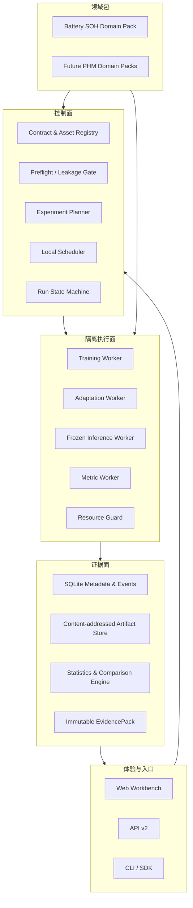
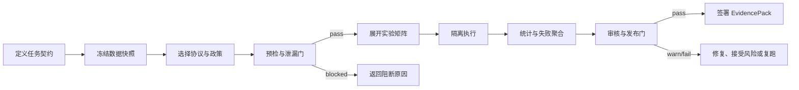
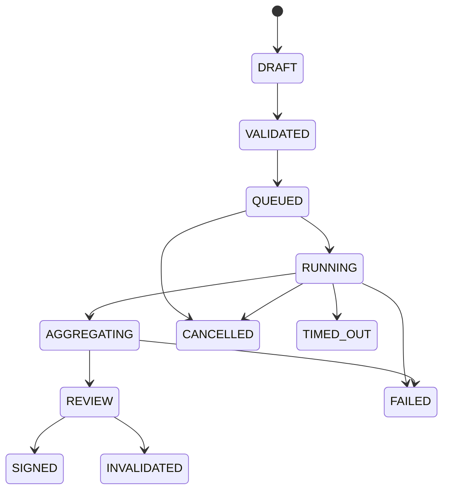

# SOH Verification Fabric 全面重构设计

## 1. 文档状态

- 状态：设计已确认，等待实施计划评审
- 交付策略：B，契约优先的渐进迁移
- 产品形态：B，本机优先的 Verification Fabric
- 界面策略：A，大幅重构
- 产品优先级：A，算法测评优先
- SOH 证据策略：在“证据中心”增加“样本与曲线”二级页

本设计基于以下输入形成：

- `D:\Agent_work\AI eval\phm_algorithm_evaluation_industry_report_2026.html`
- `D:\SOH_eval` 当前前后端、测试、任务产物与模型资产
- `D:\battery_SOH` 数据、算法、特征和曲线可视化能力
- 当前本机数据目录 `D:\battery_SOH\data`
- Codabench、MLPerf、MLflow、Kubeflow、Great Expectations、Evidently、Sigstore、NASA ProgPy、MathWorks、BatteryML、BatteryLife、Voltaiq、W&B 等公开工具的能力边界

## 2. 目标

### 2.1 第一目标：可信算法测评

平台首先要回答的不是“哪个模型分数最低”，而是：

1. 本次比较是否使用了同一任务、数据、协议、指标和发布政策。
2. 是否存在标签、未来信息、测试域统计或特征拟合泄漏。
3. 失败、超时、OOM、NaN、缺失和弃权是否被计入结论。
4. 统计单位是否为独立资产或轨迹，而不是相关滑窗。
5. 任一结论能否回溯到逐样本预测、原始曲线和不可变产物。
6. 结果能否在干净本机环境中复跑并得到一致判定。

### 2.2 第二目标：多场景 SOH 算法

只有在公平测评暴露真实失败域后，才设计跨化学体系、跨形态、跨设备、跨工况和二次寿命算法。多场景模型不是测评系统的前置条件，而是测评证据驱动的后续产品能力。

### 2.3 本机优先

- 默认在单机 Windows 环境运行。
- 元数据和事件使用 SQLite。
- 大产物使用文件系统内容寻址存储。
- 训练、迁移和推理由独立 Worker 执行。
- 保留离线 HTML 和可迁移目录包。
- 核心契约不绑定单机实现，后续可迁移到容器、队列或 HIL 资源池。

## 3. 非目标

- 不复制完整的云端 Kubernetes MLOps 平台。
- 不建设通用算法 IDE 或数据标注平台。
- 不替代专业电池仿真器、SIL/HIL 设备和 APM/EAM 系统。
- 不把平台签署结果表述为法规认证。
- 不把所有实验室、二次寿命、现场和无标签数据压缩成一个总排行榜。
- 不允许上传动作在没有用户确认的情况下直接启动大型组合矩阵。

## 4. 当前系统判断

当前主要执行链为：

```text
CLI / API
  -> registry / upload
  -> DatasetLoader
  -> metadata + QC
  -> feature transform
  -> protocol split
  -> Runner fit / predict
  -> metrics / acceptance
  -> Pickle model
  -> report
  -> frontend JSON / API
```

现有优势：

- 已形成数据、特征、协议、模型、指标和前端的完整主链。
- 已有 LOCO、LODO、LCHO、训练、冻结推理、模型持久化和部分 conformal 能力。
- 已接入多个数据集、模型资产、离线打包和 SOH 曲线页面。
- 已有较丰富的 Python 和前端静态测试。

当前 P0 风险：

- 特征可能在切分前基于全轨迹生成，存在未来信息泄漏。
- 测试表可能携带 `soh` 进入算法插件的 `predict`。
- 全失败或部分失败可能仍被外层任务标记为成功。
- Python 插件和 Pickle 可能在 API 进程内加载或执行。
- 运行目录、共享模型名和前端 latest 文件存在并发覆盖风险。
- 数据、标签、特征、环境和产物尚未形成统一内容摘要与不可变证据链。

当前 P1 风险：

- seed 未必真实注入 estimator。
- 指标均值混合 fold 和 seed，缺少资产 bootstrap、配对统计和效应量。
- 数据卡、许可、checksum、标签定义和 raw-to-summary 谱系不完整。
- 前端多个页签复用同一范围条和 KPI，训练、推理与证据语义混杂。
- 任务状态、执行结果和发布判定共用模糊的 `running/success` 字符串。

## 5. 设计原则与硬约束

以下约束在所有迁移阶段成立：

1. **目标隔离**：算法的测试视图永远不包含 SOH 真值。
2. **先切分后拟合**：填充、缩放、特征选择、特征状态、调参和校准只能在训练折或校准折拟合。
3. **同口径才可比较**：`TaskSpec + DatasetSnapshot + ProtocolSpec + MetricSpec + PolicySpec` 的比较键一致，才允许进入同一正式榜单。
4. **失败是一等结果**：失败、超时、OOM、NaN、缺失、弃权和物理违例必须进入覆盖率与发布判定。
5. **产物不可覆盖**：所有运行和产物 run-scoped、原子写入、内容寻址且可校验。
6. **API 不执行算法**：API 只验证请求、调度、查询和授权，不加载用户源码或 Pickle。
7. **运行类型分离**：训练、迁移适配和冻结推理使用独立契约与允许动作。
8. **原始证据可下钻**：任何正式结论必须能回到逐样本预测；有原始曲线的数据还应回到对应信号与特征段。
9. **签署后不可变**：签署 EvidencePack 只允许追加审计事件，不允许原位修改。
10. **静态与实时不混合**：实时 API、离线快照和演示数据在 UI 和数据层均显式区分。

## 6. 目标架构



### 6.1 体验与入口

- Web Workbench 提供实验设计、运行监控、统计比较、失败分析、资产管理和证据审核。
- API v2 只接收版本化资源引用和 RunSpec。
- CLI/SDK 与 Web 使用同一 API contract，不再拥有另一套隐藏执行语义。

### 6.2 控制面

- Registry 保存不可变 Spec、Manifest 和资产版本。
- Preflight 在创建运行前执行 schema、QC、泄漏、兼容性和资源门控。
- Planner 展开 dataset × candidate × feature × fold × seed 的执行矩阵。
- Scheduler 在本机分配 Worker、配额、租约、取消和重试。
- State Machine 通过 append-only 事件维护生命周期。

### 6.3 隔离执行面

- Training Worker 允许 `fit` 并产出 ModelArtifact。
- Adaptation Worker 只允许使用声明的目标域校准子集，并产出派生模型版本。
- Frozen Inference Worker 禁止 `fit/fine_tune/calibrate`，只执行 schema 映射、预测和时延采集。
- Metric Worker 独占测试真值，算法 Worker 只输出 PredictionRecord。
- Resource Guard 控制 CPU、内存、时间、网络和可写目录。

### 6.4 证据面

- SQLite 保存实体关系、状态、事件、review 和签署索引。
- 文件系统 CAS 使用 `artifacts/sha256/<prefix>/<digest>` 存放不可变大文件。
- Statistics Engine 读取逐样本预测和失败记录，生成聚合、CI、效应量和 Pareto 数据。
- EvidencePack 是发布、离线导出和审计的唯一事实源。

### 6.5 领域包

`D:\battery_SOH` 中可复用的数据适配、特征、算法知识和曲线视图迁移为首个 Battery SOH Domain Pack。通用控制、执行和证据内核不能依赖具体数据集名称或电池字段。

## 7. 本机存储设计

### 7.1 SQLite

建议核心表：

- `specs`
- `assets`
- `asset_versions`
- `dataset_snapshots`
- `experiments`
- `runs`
- `run_events`
- `run_attempts`
- `artifacts`
- `predictions_index`
- `reviews`
- `signatures`

数据库保存小型、可查询元数据，不保存大规模逐点曲线。

### 7.2 内容寻址存储

```text
workspace/
  metadata.sqlite3
  artifacts/
    sha256/
      ab/
        abcdef...
  run_views/
    RUN-000001/
      manifest.json
      links/
  exports/
  compatibility/
    frontend-latest/
```

- Artifact 先写临时文件，校验 digest 后原子 rename。
- `run_views` 只保存引用和小型 manifest，不复制大对象。
- 旧前端 JSON 由 EvidencePack 生成，作为 `latest` 兼容别名。

## 8. Spec 体系

### 8.1 Registry 生命周期

```text
DRAFT -> VALIDATED -> APPROVED -> DEPRECATED
```

- DRAFT 可编辑，不可进入正式运行。
- VALIDATED 通过 schema 和引用完整性验证。
- APPROVED 通过领域评审和 conformance tests。
- DEPRECATED 保留历史复现，新运行默认不可选择。

每个对象同时拥有：

- `spec_id`
- 可读 `version`
- `schema_version`
- `content_digest`
- `compatibility_key`
- `status`
- `owner`
- `provenance`
- `license`
- `created_by`
- `reviewed_by`

影响语义的修改必须产生新版本；标签和说明可以追加，但不能改变 content digest 指向的内容。

### 8.2 核心 Spec

| Spec | 主要内容 |
|---|---|
| `TaskSpec` | 目标变量、真值来源、输出 schema、聚合单位、容忍规则 |
| `DatasetSpec` | 来源、许可、化学体系、形态、单位、标签定义、分组字段 |
| `LabelSpec` | SOH 公式、额定容量、RPT/现场容量真值、缺失和插值政策 |
| `ProtocolSpec` | LOCO/LODO/LCHO/时间前推/跨域、切分单位、held-out 规则 |
| `FeatureSpec` | 特征入口、输出列、单位、原始段依赖、fit/transform contract |
| `FeaturePolicy` | 允许字段、禁用代理、fit scope、原始窗口和缺失策略 |
| `MetricSpec` | 指标方向、单位、逐样本计算、聚合、缺失和 CI 规则 |
| `PolicySpec` | 资源预算、基线、失败惩罚、物理门、UQ 门、发布阈值 |
| `CandidateSpec` | 算法、FeatureSpec、已有模型或适配器的候选装配及 digest |
| `ResourceSpec` | CPU/GPU、内存、超时、并发、网络和写目录 |
| `RunSpec` | 上述不可变引用、run type、fold、seed 和 idempotency key |

### 8.3 比较键

```text
comparison_key = SHA256(
  TaskSpec
  + DatasetSnapshot
  + ProtocolSpec
  + MetricSpec
  + PolicySpec
)
```

Candidate 是被比较对象，不进入“相同口径”的相等条件，但 CandidateSpec digest 必须写入证据。
FeatureSpec 可以作为候选的一部分发生变化；FeaturePolicy 则定义所有候选共同遵守的输入预算、禁用信息和 fit scope。因此“比较新特征方案”不会改变 comparison key，“放宽可使用的信息范围”会产生新的 comparison key。

## 9. 核心结果对象

### 9.1 DatasetSnapshot

最少包含：

- 数据内容摘要与文件清单
- 样本 manifest
- 数据卡和许可引用
- 标签版本和标签摘要
- QC 结果和剔除记录
- 原始到规范化数据的适配器版本
- target-stripped 算法视图 schema
- group 字段和 split 所需元数据

### 9.2 PredictionRecord

最少包含：

```json
{
  "run_id": "RUN-000001",
  "attempt_id": "ATT-000001",
  "sample_id": "uconn:cell_017:cycle_320",
  "asset_id": "cell_017",
  "cycle_id": 320,
  "y_pred": 0.839,
  "interval_low": 0.774,
  "interval_high": 0.852,
  "abstained": false,
  "predict_ms": 13.49,
  "status": "ok"
}
```

PredictionRecord 不包含测试真值。Metric Worker 通过 `sample_id` 与内部真值连接。

### 9.3 EvidencePack

最少包含：

- run、experiment 和 parent experiment
- 五类比较 Spec 版本与 digest
- Candidate、模型、插件、环境和依赖 digest
- DatasetSnapshot、LabelSpec、sample manifest 和 split manifest
- 硬件、seed、命令、资源限制和 attempt
- 逐样本预测索引
- 逐资产和逐域指标
- bootstrap CI、配对比较、效应量和多重比较修正
- coverage、abstention 和全部失败记录
- 日志和 artifact digest
- 物理约束和 UQ gate
- review、签名、actor 和时间戳

## 10. 评测 Workflow



### 10.1 预检门

- 数据门：标签、重复、单位、范围、轨迹长度、许可、来源。
- 泄漏门：group overlap、目标列、未来数据、fit scope、代理特征。
- 接口门：输入 schema、输出 schema、模型特征 schema、依赖。
- 比较门：比较键、预算类别、baseline 和 seed 规则。
- 资源门：预计组合数、磁盘、内存、时间和并发。

### 10.2 用户确认

上传数据、算法、特征或模型后：

1. 自动创建资产草案。
2. 自动执行静态验证和 conformance tests。
3. 自动生成测评草案、组合数量和资源估计。
4. 用户确认后冻结 RunSpec。
5. 只有冻结 RunSpec 可以进入队列。

## 11. 运行类型

### 11.1 Training Run

- 输入：训练可用 DatasetSnapshot、AlgorithmPackage、FeaturePackage。
- 允许：训练折 `fit`、训练折特征拟合、产出 ModelArtifact。
- 禁止：算法访问测试真值、在全数据上拟合特征状态。
- 输出：fold 模型、逐样本预测、训练资源和 EvidencePack。

### 11.2 Adaptation Run

- 输入：基础模型 digest、目标域校准子集、独立目标留出集。
- 允许：声明式 recalibration、adapter 或 fine-tune。
- 禁止：使用目标留出标签、覆盖基础模型。
- 输出：派生模型 digest、适配成本和目标留出证据。

### 11.3 Frozen Inference Run

- 输入：ModelArtifact、未见 DatasetSnapshot、schema mapping。
- 允许：目标剥离视图的 `predict`、冷/热启动时延和吞吐采集。
- 禁止：`fit`、fine-tune、自动目标标签校准。
- 输出：迁移精度、时延、吞吐、内存、弃权和兼容性证据。

## 12. 运行状态语义

### 12.1 生命周期 `execution_state`



### 12.2 执行结果 `outcome`

- `complete`
- `partial`
- `failed`
- `timed_out`
- `cancelled`
- `invalid`

### 12.3 发布判定 `verdict`

- `pass`
- `warn`
- `fail`
- `not_applicable`
- `not_reviewed`

三个字段不得互相代替。例如：

```text
execution_state = REVIEW
outcome = partial
verdict = warn
```

每次状态转换必须记录 actor、reason、attempt、checkpoint 和时间戳。

默认映射规则：全部执行单元失败时 `outcome=failed`；至少一个成功且至少一个失败时 `outcome=partial`；所有必需单元成功时 `outcome=complete`。基础设施异常可以重试并产生新 attempt，但不能删除旧 attempt。`SIGNED` 表示证据已冻结，不等于 `verdict=pass`；失败或警告证据也可以签署留档，但不能绕过排行榜资格政策。

## 13. 失败分类

- `INPUT_CONTRACT`
- `DATA_QC`
- `LEAKAGE`
- `ALGORITHM`
- `RESOURCE`
- `INFRASTRUCTURE`
- `METRIC`
- `POLICY`

基础设施重试不能覆盖原始 attempt；所有 attempt 均进入 EvidencePack。算法失败和资源失败不得从聚合分母中静默删除。

## 14. 插件与资产治理

### 14.1 插件类型

| 类型 | 输入 | 输出 | 执行位置 |
|---|---|---|---|
| Dataset Adapter | 原始文件、DatasetSpec | Canonical data、manifest | Ingest Worker |
| Feature Package | 训练视图或目标剥离视图 | FeatureState、feature matrix | Evaluation Worker |
| Algorithm Package | 训练特征和训练标签 | ModelArtifact | Training Worker |
| Model Artifact | Pickle、ModelManifest | PredictionRecord | Frozen Inference Worker |
| Metric Plugin | PredictionRecord、内部真值 | 指标记录 | Metric Worker |
| Visualization Plugin | 已签署 EvidencePack | 图表描述或静态资产 | Evidence Reader |

### 14.2 信任级

- T1 内置已审查：项目维护，仍通过 Worker 执行。
- T2 可信本机：用户上传源码、特征插件或带 Manifest 的 Pickle；子进程、无网络、只读数据、限额执行。
- T3 外部未信任：必须容器或 microVM；隔离能力未启用前禁止执行。

### 14.3 Pickle 规则

- API 进程永不 `pickle.load`。
- Pickle 必须与 ModelManifest 一起注册。
- Manifest 包含训练 run、算法、特征 schema、runtime、依赖、Python 版本和 digest。
- Worker 加载前验证内容摘要和 schema。
- Pickle 只用于可信本机或更强隔离级别，并在 UI 显示不安全序列化提示。

## 15. 统计与发布规则

### 15.1 统计单位

- 默认以电芯、系统或独立轨迹为 bootstrap 单位。
- 相关 cycle/window 不得作为独立 CI 样本。
- 同 fold 候选使用配对统计。
- 跨数据集比较报告效应量和多重比较修正。

### 15.2 最低输出

- mean、median、std 和 95% CI
- asset/fold/seed 数
- attempted/succeeded/failed 数
- coverage 和 abstention
- 每域和最坏域指标
- 物理违例率
- UQ 的 PICP、MPIW 和 selective risk
- 冷/热推理时延、吞吐和峰值内存

### 15.3 排行榜资格

只有满足以下条件的运行进入正式榜单：

- `execution_state = SIGNED`
- comparison key 相同
- outcome 和 coverage 满足 PolicySpec
- 无未接受的泄漏、schema 或证据完整性问题
- baseline 已执行
- 统计字段完整

开发榜和正式盲测榜分离。默认使用 Pareto 和分项指标，不创建无依据的单一总分。

## 16. Battery SOH Domain Pack

建议目录：

```text
domain_packs/battery_soh/
  domain.yaml
  datasets/
  labels/
  adapters/
  features/
  algorithms/
  protocols/
  metrics/
  policies/
  visualizations/
  golden/
```

### 16.1 规范数据层

支持两种粒度：

- `CanonicalTrajectory`：循环内时间、V/I/T/Q、phase、step 和原始引用。
- `CanonicalCycleSummary`：每循环 SOH、容量和经过声明的统计/曲线特征。

稳定主键至少包括：

- `dataset_id`
- `snapshot_id`
- `asset_id`
- `cycle_id`
- `phase_id`
- `sample_id`

### 16.2 特征谱系

每个特征记录：

- feature id 和版本
- value、unit 和 missing status
- raw segment reference
- 时间窗、电压窗、SOC 窗或 step 范围
- smoothing/interpolation 参数
- FeatureState digest
- fit scope

“高亮特征段”只表示特征来源，不等同于模型因果解释。SHAP、注意力或其他归因必须作为独立证据类型。

## 17. SOH/LFP 测评赛道

### 17.1 核心公平榜

- 当前 7 数据集。
- 统一 cycle-summary 特征预算。
- 统一 LOCO/LODO、经典基线、3 seeds 和资产级 CI。
- 第一目标是生成首个可签署的公平排行榜。

### 17.2 LFP 曲线诊断榜

- HUST、SNL、UConn、CALCE A123 等具有原始曲线的数据。
- 比较部分充电窗口、脉冲/DCIR、IC/DVA、V/I/T 和平滑策略。
- 报告窗口覆盖率、缺失机制和 feature availability。

### 17.3 跨域迁移榜

- zero-shot、few-shot 和 supervised adaptation 三榜分离。
- 覆盖跨协议、实验室、化学体系和形态。
- 报告最坏域、适配数据量、适配时长和校准收益。

### 17.4 二次寿命与现场榜

- 优先补充 UConn 108-cell second-life LFP 数据。
- RWTH HSS 使用现场容量测试形成独立系统级赛道。
- `real_ESS` 和 M5BAT 在缺少可信容量真值时进入 OOD/HI/漂移赛道，不进入监督 SOH 总榜。

### 17.5 部署推理榜

- 冻结 Pickle、schema 兼容、冷/热时延、吞吐、内存和弃权。
- 精度和工程性能使用 Pareto，不将时延隐藏在说明文字中。

## 18. LFP 专项政策

- LFP 电压平台使固定电压窗的信息密度变化，必须报告窗口覆盖率和敏感性。
- 脉冲/DCIR 不再全局禁止，改为按赛道和 PolicySpec 显式声明。
- 首寿命、二次寿命和现场数据分别定义 LabelSpec 和 ProtocolSpec。
- 加强大型方形、模组、户储、站级、日历老化和间歇容量真值覆盖。
- 跨化学结论原则上要求每个声明体系至少两个独立来源，避免把实验室效应误认为化学差异。

## 19. 前端信息架构

### 19.1 全局壳层

- 单一左侧导航，不再保留重复顶部页签。
- 顶部上下文栏显示 workspace、实时/离线来源、当前 comparison scope 和系统入口。
- 桌面侧栏 224px，上下文栏 56px，主内容使用 8px spacing rhythm。
- 表格行提供舒适和紧凑两档；动态状态不改变布局尺寸。
- 长列表固定高度、sticky header、内部滚动和虚拟化。

### 19.2 顶层页面

| 页面 | 唯一职责 |
|---|---|
| 可信总览 | 发布准备度、阻断项、最新签署结论和运行健康 |
| 实验设计 | 任务、数据、候选、协议、政策、预检和 RunSpec 冻结 |
| 运行中心 | 队列、事件时间线、attempt、取消、失败复跑和持续时间 |
| 比较实验室 | 同口径 CI、配对比较、Pareto、排行榜和送审 |
| 跨域泛化 | transfer matrix、最坏 held-out 域和适配成本 |
| 失败分析 | 失败分类、影响范围、最小复现和复跑草案 |
| 数据与协议 | 数据卡、QC、许可、snapshot 和 split/fit-scope 预览 |
| 模型与推理 | 模型 Registry、谱系、schema 和 Frozen Inference Run |
| 证据中心 | 结论谱系、样本曲线、审核、签署和离线导出 |

### 19.3 旧页面映射

- 训练测评 -> 实验设计 + 运行中心 + 模型与推理
- 推理测评 -> 模型与推理 + 跨域泛化
- 模型资产 -> 模型与推理的 Registry 视图
- 算法推荐 -> 比较实验室的同口径结论
- 全局诊断 -> 可信总览 + 数据与协议 + 失败分析
- SOH 完整看板 -> 证据中心的样本与曲线
- 同步、API 健康和离线打包 -> 右上角系统菜单

## 20. SOH 样本与曲线证据页

该页面是证据中心二级页，不新增顶层导航。

### 20.1 入口

- 比较实验室候选行或最坏资产
- 跨域泛化热力矩阵单元
- 失败分析中的具体样本
- 数据与协议中的 data-only 浏览模式
- 直接 URL：run、sample、cycle 和对比选择可恢复

### 20.2 联动行为

点击 SOH 轨迹点后同步显示：

- SOH 真值、预测、置信区间和误差
- 充放电 V/I/T/Q 曲线
- IC、DVA 和可用脉冲/DCIR 曲线
- q_win、t_win、IC 峰等特征的原始高亮段
- 原始点、处理前后曲线和 smoothing/interpolation 参数
- DatasetSnapshot、FeatureState、ModelArtifact 和 PredictionRecord 谱系
- QC、缺失、覆盖和物理约束状态

支持 Shift 多选最多三个循环、brush/zoom、raw/processed 切换和表格后备。

### 20.3 数据链接契约

```text
sample_id
  -> RawSegmentRef
  -> FeatureProvenance
  -> PredictionRecord
  -> MetricContribution
```

缺少原始曲线的数据集必须显示不可用原因和覆盖率，不能生成伪曲线。

### 20.4 性能与离线策略

- 本机 API 按 asset/cycle 分段读取和缓存，不一次加载完整大数据集。
- 前端对曲线进行视窗化和降采样，但保留原始点下载引用。
- 离线包始终包含全部数据集的聚合结果、逐数据集结果、逐样本预测索引、失败记录和完整 manifest。
- 默认只内嵌代表、最坏、失败和用户固定样本的高频原始曲线；其他样本保留 coverage 和内容引用。
- 完整原始曲线打包必须显式选择，并提前显示预计体积。

## 21. API v2 边界

建议端点组：

```text
GET    /api/v2/registry/{kind}
POST   /api/v2/assets/datasets
POST   /api/v2/assets/algorithms
POST   /api/v2/assets/features
POST   /api/v2/assets/models
POST   /api/v2/preflight
POST   /api/v2/experiments
POST   /api/v2/runs
GET    /api/v2/runs/{run_id}
GET    /api/v2/runs/{run_id}/events
POST   /api/v2/runs/{run_id}/cancel
POST   /api/v2/runs/{run_id}/retry
GET    /api/v2/comparisons
GET    /api/v2/evidence/{evidence_id}
GET    /api/v2/evidence/{evidence_id}/samples
GET    /api/v2/evidence/{evidence_id}/samples/{sample_id}/curves
POST   /api/v2/evidence/{evidence_id}/review
POST   /api/v2/evidence/{evidence_id}/sign
```

- 所有写请求支持 idempotency key。
- 所有错误返回分类、稳定错误码、影响范围和 correlation id。
- v1 API 在迁移期通过 compatibility adapter 调用新内核。

## 22. 渐进迁移

### Phase 0：契约和证据双写

范围：

- 引入核心 schema、RunSpec、DatasetSnapshot 和 EvidencePack。
- 修复目标剥离、先切分后拟合、seed 注入和失败语义。
- 现有执行链继续工作，同时生成新证据。
- 旧 JSON/HTML 由新证据生成或进行一致性核对。

退出门：

- 构造泄漏全部被拒绝。
- 全失败为 failed，部分失败为 partial。
- 同秒并发运行不覆盖。
- 同一运行的新旧结果可自动核对。
- 干净环境可验证内容摘要和结果。

### Phase 1：Worker 与状态机

范围：

- SQLite event store、状态机和本机调度器。
- Training、Adaptation、Inference 和 Metric Worker 分离。
- 超时、取消、资源限制和 attempt。
- CAS 原子产物存储。

退出门：

- 挂起或异常插件不会拖垮 API。
- 刷新前端可恢复运行状态。
- API 进程不加载算法源码或 Pickle。
- 运行事件可回放得到同一最终状态。

### Phase 2：前端 V2

范围：

- 新壳层和九个顶层页面。
- 可信总览、实验设计、运行中心、比较实验室优先。
- 数据/模型资产、跨域、失败和证据页面迁移。
- 样本与曲线证据页。

退出门：

- 无重复导航和全局 KPI 语义混用。
- 每页只有一个主决策。
- 任一正式结论三步内到逐样本证据。
- 长列表不撑高页面，375/768/1024/1440px 无溢出。
- 实时、快照和演示数据不混合。

### Phase 3：可信发布与外部插件

范围：

- 容器或 microVM 隔离。
- T3 外部插件。
- EvidencePack 签名、SBOM、隐藏测试和发布审批。
- 为 SIL/HIL connector 预留资源接口。

退出门：

- 文件、网络和资源越界测试全部被阻断。
- 签署产物被篡改时可检测。
- 开发榜和隐藏正式榜完全隔离。

## 23. SDD/TDD 测试策略

实现顺序必须是 Spec -> failing test -> minimal implementation -> refactor -> evidence review。

### 23.1 Contract tests

- 所有 Spec 的 schema、版本和引用完整性。
- comparison key 稳定性。
- v1/v2 compatibility adapter。

### 23.2 Leakage adversarial tests

- `predict` 看不到目标列。
- 测试域统计无法进入 FeatureState。
- 同一 asset 不跨 train/test。
- 时间前推不读取未来 cycle。
- 禁用代理特征被拒绝或按政策隔离。

### 23.3 Plugin conformance tests

- 正常输出、错误 shape、NaN、挂起、OOM 模拟和越权文件访问。
- FeaturePackage 的 train-only fit。
- ModelArtifact schema mismatch。
- Frozen Inference 禁止 fit/calibration。

### 23.4 Golden and reproducibility tests

- 小型黄金数据集的 split、预测、统计和 EvidencePack digest。
- 同 seed 结果一致，不同 seed 确实进入 estimator。
- 进程重启后模型重载预测一致。
- 新旧双写结果一致。

### 23.5 Statistical tests

- 每 asset 轨迹指标，不跨 cell 全局排序。
- bootstrap CI、配对统计、效应量和失败分母。
- partial coverage 和 abstention 不显示为零或成功。

### 23.6 Browser tests

- 创建实验、预检阻断、启动、取消、复跑、刷新恢复。
- 同口径筛选和不可比结果阻断。
- 排行榜到原始曲线三步内可达。
- 模型/数据列表固定高度和键盘操作。
- 加载、空、错误、离线和 stale 状态。

### 23.7 Security tests

- API 不反序列化 Pickle。
- Worker 网络、文件和资源边界。
- Artifact digest 和签名篡改检测。
- 路径穿越、压缩包炸弹和依赖声明验证。

## 24. 多 Agent 开发治理

每轮实现使用独立写入范围：

| 角色 | 责任 | 禁止事项 |
|---|---|---|
| 架构 Agent | Spec、ADR、兼容策略、接口审查 | 不实现业务逻辑 |
| 契约测试 Agent | schema、状态机、泄漏和失败语义红灯测试 | 不放宽测试迁就实现 |
| 控制面 Worker | Registry、RunSpec、SQLite、scheduler | 不触碰执行插件实现 |
| 执行面 Worker | Worker、数据视图、资源守卫、插件接口 | 不修改前端契约 |
| 证据 Worker | CAS、PredictionRecord、统计、EvidencePack | 不运行用户代码 |
| 前端 Worker | 新壳层、页面和浏览器测试 | 只消费冻结 API contract |
| 审查 Agent | 只读复核泄漏、复现、统计和证据完整性 | 不直接修补被审查模块 |

每个 Agent 必须声明写入文件范围；集成前运行契约测试和黄金闭环。

## 25. 可观测性与性能

- 每个请求、run、attempt 和 Worker 使用 correlation id。
- 记录队列等待、执行、聚合和审核各阶段耗时。
- 资源采集包括 CPU、内存、GPU、磁盘、冷/热推理时延和吞吐。
- 前端使用事件流或轮询恢复，不依赖页面内存中的任务状态。
- 大表分页或虚拟化；大曲线按区间降采样并保留原始引用。
- 日志是 Artifact，不能作为唯一状态源。

## 26. 验收指标

北极星指标：**通过全部 gate 的可审计有效比较次数**。

辅助指标：

- 泄漏对抗测试拦截率 100%。
- 签署 EvidencePack 摘要验证率 100%。
- 正式榜单中比较键不一致条目为 0。
- 全失败误标成功次数为 0。
- 任一结论到逐样本证据不超过 3 次交互。
- 活动 run 页面刷新恢复率 100%。
- 同一黄金运行复跑得到相同 verdict。
- 原始曲线可用率和缺失原因可量化。
- 7 数据集核心公平榜具备资产级 95% CI、coverage 和失败明细。

## 27. 风险与缓解

| 风险 | 缓解 |
|---|---|
| 大幅重构影响当前可用功能 | 契约双写、compatibility adapter、旧页面 latest 别名 |
| SQLite 并发写限制 | 单写事件服务、短事务、WAL；扩展时可替换元数据后端 |
| Pickle 安全风险 | API 不加载、T2 Worker、digest、manifest；T3 等待容器 |
| 原始曲线体积过大 | CAS、分段读取、降采样、按需离线打包 |
| 数据许可和标签不明确 | DatasetSpec 阻断正式榜单，允许仅用于本地探索 |
| 多赛道增加理解成本 | 可信总览给出推荐路径，不制造一个错误总分 |
| 统计复杂度降低可读性 | 默认结论 + CI，细节可下钻；提供数值表和解释文本 |
| 旧结果无法完全复现 | 标记 legacy evidence，不伪造缺失 manifest 或环境摘要 |

## 28. 已确认决策

1. 采用本机优先 Verification Fabric，而不是先建设云平台。
2. 采用契约优先渐进迁移，而不是一次性替换。
3. 前端大幅重构，旧页面能力重新分配。
4. 算法测评优先，多场景算法第二。
5. 训练、迁移适配和冻结推理分离。
6. Model upload 使用 Pickle + ModelManifest，API 不反序列化。
7. 上传任意新资源触发预检和实验草案，用户确认后执行。
8. 现场无真值数据不进入监督 SOH 榜单。
9. 证据中心增加“样本与曲线”二级页。
10. SOTA 对标采用组合范式，不复制单一产品。

## 29. 延后决策

以下决策不阻塞 Phase 0：

- Phase 3 使用 Docker、Podman、Windows Sandbox 还是 microVM。
- EvidencePack 使用本机密钥、Sigstore 还是组织 PKI 签名。
- HIL connector 的首个供应商和实时总线。
- 多用户 RBAC 的身份提供方。
- 隐藏测试集的托管和更新周期。

## 30. 主要外部参考

- [Codabench](https://docs.codabench.org/latest/)
- [MLPerf Benchmarks](https://mlcommons.org/benchmarks/)
- [MLflow Evaluation](https://mlflow.org/docs/latest/ml/evaluation)
- [Kubeflow Artifacts](https://www.kubeflow.org/docs/components/pipelines/user-guides/data-handling/artifacts/)
- [Great Expectations Checkpoints](https://docs.greatexpectations.io/docs/reference/api/checkpoint_class/)
- [Evidently Data Drift](https://docs.evidentlyai.com/metrics/preset_data_drift)
- [Sigstore](https://docs.sigstore.dev/)
- [NASA ProgPy](https://nasa.github.io/progpy/guide.html)
- [MathWorks Battery Differential Curves](https://www.mathworks.com/help/predmaint/ref/batterydifferentialcurves.html)
- [Voltaiq Battery Analytics](https://www.voltaiq.com/platform)
- [W&B Tables](https://docs.wandb.ai/guides/models/tables/)
- [BatteryML](https://github.com/microsoft/BatteryML)
- [BatteryLife](https://github.com/Ruifeng-Tan/BatteryLife)
- [UConn LFP First-life Dataset](https://digitalcommons.lib.uconn.edu/reil_datasets/5/)
- [UConn LFP Second-life Dataset](https://digitalcommons.lib.uconn.edu/reil_datasets/3/)
- [ISU-UConn Emulated Degradation Dataset](https://digitalcommons.lib.uconn.edu/reil_datasets/6/)
- [RWTH Home Storage Field Dataset](https://www.nature.com/articles/s41560-024-01620-9)
